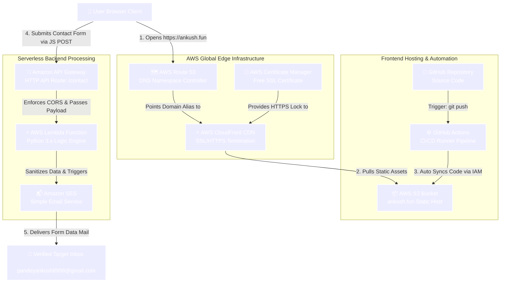

# 🚀 Production-Grade AWS Serverless Portfolio Infrastructure (`ankush.fun`)

A high-performance, enterprise-grade personal portfolio platform engineered on a 100% Serverless AWS Infrastructure. The frontend application utilizes globally distributed delivery node layers to secure and fetch multi-layered web files asynchronously, eliminating server overhead costs. The contact subsystem leverages dynamic serverless event ingestion routes to process spam-protected contact ingest vectors securely into verified administrator streams.

---

## 🏗️ Project Architecture & Connection Diagram

---

## 🛠️ Technical Implementation Architecture Matrix

### 1. Authoritative DNS & Secure Edge Layer (AWS Route 53 & CloudFront)
* **Domain Registry Routing:** Transferred active namespace authorization controllers for `ankush.fun` from external registrars over onto an **AWS Route 53 Hosted Zone**.
* **Global Content Delivery Network:** Mapped root web queries to **AWS CloudFront Edge Locations** to ensure globally minimized latency via asset caching mechanisms.
* **SSL/TLS Automated Encryption:** Configured an **AWS Certificate Manager (ACM)** public certificate to enforce automated wildcard-ready HTTPS connection profiles globally, establishing hard encryption standards and a `Redirect HTTP to HTTPS` viewer protocol routing matrix.

### 2. Static Asset Storage Layer (AWS S3)
* **High-Availability Web Hosting:** Deployed core application static modules (`index.html`, style arrays, and scripts) directly into a decoupled object storage system optimized for zero-compute static endpoint evaluation.
* **Access Boundary Protection:** Hard-coded specific Bucket Resource Policies restricted explicitly to granular read operations (`s3:GetObject`), eliminating surface exposures to administrative data buckets.

### 3. Serverless Event Ingestion Backend (AWS Lambda & API Gateway)
* **Decoupled API Endpoint Vector:** Form actions route asynchronously through an **Amazon API Gateway HTTP API** layer, executing strict cross-origin preflight handshakes (CORS) bound to explicit routing targets.
* **Serverless Compute Logics:** The backend logic operates isolated within an **AWS Lambda function** environment leveraging Python. Compute lifecycle resources activate on-demand, terminating costs during application idle periods.
* **Data Sanitization Enforcements:** Custom structural processing filters reject empty variants, missing schemas, or corrupt payload definitions before authorizing target operations.

### 4. Downstream Mail Delivery Processing (AWS SES)
* **Identity Ingestion Pipeline:** Outbound notifications process securely through highly restricted **Amazon SES** sandboxed pipelines bound to explicitly verified target email communication systems.
* **Delivery Framework:** Automatically compiles sanitized data feeds incoming from the backend computational layers and processes downstream outbound delivery calls over secure transport layers.

---

## 🔄 Automated CI/CD Lifecycle Pipeline (GitHub Actions)

The platform repository features an autonomous infrastructure sync workflow that updates web views immediately without manual intervention:

1. **Trigger Condition:** Pushes or merged branches targeting the codebase core branch immediately awaken the automated runner frameworks.
2. **Secure Key Exchange:** Temporary runner containers connect securely using abstracted environment secrets containing highly restrictive deployment access signatures.
3. **Differential File Syncing:** Automation commands evaluate active asset differences and run an administrative synchronization routine to update modified components on the live application layer instantly.
## ⚠️ Challenges Faced & Troubleshooting (Errors Resolved)

During the migration from EC2 to a 100% Serverless architecture, we encountered and resolved the following real-world engineering challenges:

### 1. Cross-Region Routing & Preflight Errors (HTTP 404 / CORS)
* **Problem:** Initially, the API Gateway was accidentally deployed in the `us-east-1` (N. Virginia) region while the Lambda function logic was running in `ap-south-1` (Mumbai). This cross-region handshake misconfiguration caused a standard browser Preflight `OPTIONS` request to fail with an `HTTP 404 Not Found` and triggered a strict CORS policy block on the client-side network tab.
* **Solution:** Teardown the legacy distribution and re-engineered a clean, regional **HTTP API Gateway directly inside the Mumbai (`ap-south-1`) region**, binding it locally to the Lambda endpoint.

### 2. Strict API Gateway CORS Handshake Block
* **Problem:** Even after fixing the region, form submissions were still dropped by browsers because the new HTTP API Gateway had no explicit origin mapping by default (`No Origins are allowed`), creating standard cross-origin fetch failures.
* **Solution:** Manually configured the **CORS configuration layer inside the AWS API Gateway console** by explicitly setting:
  * `Allowed Origins` = `*` (or the specific production domain)
  * `Allowed Headers` = `content-type`
  * `Allowed Methods` = `POST, OPTIONS`

### 3. AWS Global Edge SSL/TLS Location Restriction
* **Problem:** AWS CloudFront is a globally distributed CDN infrastructure. Due to core AWS platform constraints, custom SSL/TLS certificates generated inside regional ACM endpoints (like Mumbai) are completely hidden from CloudFront's alternate domain mapping drop-downs.
* **Solution:** Temporarily routed configuration parameters into the **North Virginia (`us-east-1`) ACM interface** to request and validate the free public wildcard SSL certificate, enabling CloudFront to securely attach and enforce global HTTPS connections.

### 4. New AWS Account Verification Gate
* **Problem:** Since this was a completely fresh AWS account identity, automated platform security shields temporarily throttled the generation of edge CDN instances, presenting the error: *"Your account must be verified before you can add new CloudFront resources."*
* **Solution:** Raised an official diagnostic validation query inside the **AWS Support Center** under the `Account & Billing Activation` matrix. The AWS engineering support tier manually audited the configuration constraints and permanently unblocked edge provisioning capabilities within hours.
